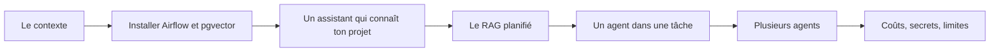

# Pourquoi orchestrer une application LLM

Ton assistant des modules 1 et 2 marche dans un notebook. Maintenant, imagine-le en vrai, pour les étudiants du cours :

- la FAQ change **chaque jour** : de nouvelles entrées, des réponses corrigées. Qui relance l'ingestion, et qui recalcule les embeddings ?
- l'API d'OpenAI répond parfois `429 Too Many Requests`, ou met une minute à répondre. Qui réessaie, et combien de fois ?
- chaque question coûte des tokens. Qui garde la trace de ce que chaque exécution a consommé ?
- un agent peut boucler, appeler dix fois le même outil, ou rendre un JSON invalide. Où voit-on ce qu'il a fait ?

Un **orchestrateur** répond à ces questions, pour une application LLM comme pour un pipeline de données. Tu en connais déjà un : **Airflow**, du Zoomcamp DE. Ce module te montre comment il porte les trois pièces de ce cours : le **RAG** (une ingestion planifiée, des questions à la demande), les **agents** (une boucle dans une tâche), et **plusieurs agents** qui travaillent ensemble.

## 🔑 Ce qui change avec l'IA

Un pipeline de données classique est **déterministe** : les mêmes entrées donnent les mêmes sorties. Une tâche qui appelle un LLM ne l'est pas : deux exécutions peuvent donner deux réponses différentes, de longueurs différentes, à des coûts différents. Tout le module tourne autour de cette différence :

| Dans un pipeline classique | Dans une tâche qui appelle un LLM |
| --- | --- |
| Une erreur est un bug à corriger | Une erreur est souvent passagère (limite de débit, délai) : on **réessaie** |
| Le coût est celui de la machine | Le coût se compte en **tokens**, à chaque appel |
| La sortie se vérifie une fois | La sortie se **valide** à chaque exécution (un JSON, un format) |
| Le chemin est fixé à l'avance | Avec un agent, le modèle **choisit** le chemin |

## Le cours officiel utilise Kestra

Le module officiel de la cohorte 2026 est fait avec **Kestra**, un orchestrateur qui décrit les flows en YAML et qui a des tâches IA toutes faites. Ici, comme dans ton Zoomcamp DE, on le refait avec **Airflow 3** : tu gardes un seul orchestrateur, celui que les entreprises utilisent le plus, et tu écris toi-même ce que Kestra cache. Les idées et les étapes restent celles du cours : le contexte, un assistant pour écrire les pipelines, le RAG, les agents, plusieurs agents, les bonnes pratiques. Le homework reprend les six questions officielles.

Les vidéos officielles sont proposées dans chaque leçon : les exemples sont avec Kestra, mais les idées sont les mêmes. Le texte officiel est sur GitHub, dans `03-orchestration/` de ton fork.

@@ brief
- Une application LLM en production a besoin de ce qu'un orchestrateur apporte : **planifier** l'ingestion, **réessayer** les appels qui échouent, **garder** l'historique et les coûts de chaque exécution.
- Une tâche qui appelle un LLM n'est **pas déterministe** : mêmes entrées, réponses différentes, coûts différents. On la traite autrement qu'une tâche SQL.
- 🔑 Le cours officiel utilise Kestra ; on le refait avec **Airflow 3**, que tu connais du Zoomcamp DE. Mêmes étapes : le contexte, un assistant IA, le RAG, les agents, plusieurs agents, les bonnes pratiques.

@@ declic
- [DE:02-01] Au Zoomcamp DE, tu as choisi un orchestrateur parce qu'un cron ne suffisait plus : relances, historique, dépendances. Ici, ce sont les mêmes raisons, plus une : les appels au LLM échouent souvent pour des raisons passagères.
- [02-07] À la leçon 7 du module 2, l'ingestion et l'application étaient deux scripts séparés. Airflow va planifier le premier et lancer le second à la demande.

@@ teaser
- [03-05] À la leçon 5, ton ingestion vers pgvector tourne toute seule chaque jour, et une vérification se lance après chaque mise à jour.
- [03-07] À la leçon 7, deux agents travaillent ensemble, et tu sauras combien ils coûtent vraiment.

@@ explain
Pourquoi une tâche qui appelle un LLM doit-elle être traitée différemment d'une tâche qui charge un CSV ? Donne deux différences concrètes.

@@ cles
- L'orchestration de l'IA | llm pipeline orchestration airflow | Faire tourner une application LLM en production : planifier, réessayer, observer.
- Le non-déterminisme des LLM | llm non deterministic output production | Pourquoi on valide et on mesure chaque sortie d'un modèle.

@@ resources
- [Le module officiel avec Kestra, dans ton fork](https://github.com/gitabdelhub/llm-zoomcamp/tree/main/03-orchestration)
- [La documentation d'Airflow 3](https://airflow.apache.org/docs/apache-airflow/3.3.2/index.html)
