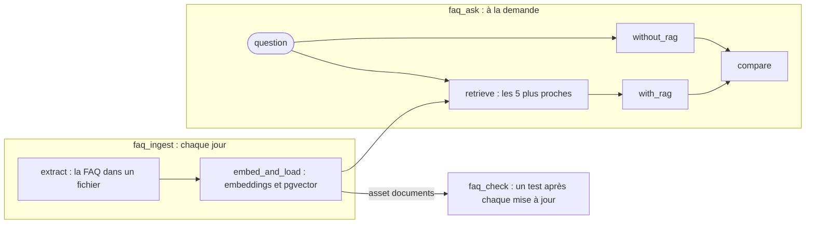

# Le RAG planifié dans Airflow

Le RAG a deux phases, et tu les as déjà séparées au module 2 (leçon 7) : l'**ingestion**, qui calcule les embeddings et remplit la base, et la **question**, qui cherche puis appelle le modèle. Dans un orchestrateur, elles deviennent deux DAG différents, avec deux rythmes différents.

## Trois DAG, trois rôles

- **`faq_ingest`** tourne chaque jour (`schedule="@daily"`). Sa tâche `extract` écrit la FAQ dans un fichier de `data/` et ne passe à la suivante que son **chemin**. La tâche `embed_and_load` calcule les embeddings par lots de 50, avec l'`Embedder` ONNX du module 2, et fait un upsert dans pgvector.
- **`faq_ask`** ne se planifie pas (`schedule=None`) : on le lance à la main, avec un **paramètre** `question`. Il refait l'expérience des flows 1 et 2 du cours officiel : la même question, posée **sans** RAG et **avec** RAG, en deux branches parallèles, puis une tâche qui compare les deux réponses et leurs tokens.
- **`faq_check`** ne se lance ni à heure fixe ni à la main : il se lance **quand la table change**. C'est le rôle des **assets** d'Airflow 3.

## 🔑 Les assets : planifier sur une donnée, pas sur une heure

Une tâche déclare qu'elle met à jour une donnée avec `outlets=[FAQ_TABLE]`, où `FAQ_TABLE = Asset("postgres://pgvector:5432/faq/public/documents")`. Un autre DAG déclare `schedule=[FAQ_TABLE]` : Airflow le lance chaque fois que la tâche productrice réussit. L'adresse de l'asset est un simple identifiant : Airflow ne se connecte pas à la base pour la vérifier.

Ici, `faq_check` cherche « Is it possible to enroll late? » et vérifie que l'entrée sur l'inscription arrive en premier. Si une mise à jour de la FAQ ou du modèle casse la recherche, tu le sais tout de suite, pas le jour où un étudiant pose la question.

## 🔑 XCom pour les petites choses, des fichiers pour les grosses

Ce qu'une tâche `@task` renvoie passe à la suivante par **XCom**, rangé dans la base de métadonnées d'Airflow. C'est fait pour des petites valeurs : un chemin, un nombre, cinq documents. Pas pour 1 500 entrées de FAQ, ni pour une matrice d'embeddings : ces données vont dans un fichier (ou un stockage objet), et XCom ne transporte que leur adresse.

## RAG statique ou recherche web

Le cours officiel montre aussi un RAG qui cherche sur le web au moment de la question (avec Tavily), sans ingestion. La règle reste la même avec Airflow :

| | RAG statique (ce DAG) | RAG par recherche web |
| --- | --- | --- |
| Source | Les documents que tu as ingérés | Les résultats du web au moment de la question |
| Pour | Une FAQ, des procédures, une base fixe | Une information qui change plus vite que ton ingestion |
| Ingestion | Nécessaire, planifiée | Aucune |
| Exemple | « Can I still join the course? » | « Quelle est la dernière version d'Airflow ? » |

@@ brief
- Deux phases, deux DAG : `faq_ingest` planifié chaque jour (la FAQ, les embeddings, pgvector), `faq_ask` à la demande, avec un **paramètre** `question`.
- `faq_ask` refait les flows 1 et 2 du cours : la même question sans RAG et avec RAG, en **parallèle**, puis une comparaison des réponses et des tokens.
- 🔑 Les **assets** : `outlets=[FAQ_TABLE]` sur la tâche qui écrit, `schedule=[FAQ_TABLE]` sur un DAG de vérification, lancé après chaque mise à jour.
- 🔑 XCom transporte des **petites** valeurs (un chemin, cinq documents). Les grosses données vont dans un fichier.

@@ schema
~~~mermaid
sequenceDiagram
    participant S as Scheduler
    participant I as faq_ingest
    participant P as pgvector
    participant C as faq_check
    S->>I: chaque jour à minuit
    I->>I: extract : faq_2026-11-16.json
    I->>P: embed_and_load : upsert de 1470 lignes
    I-->>S: l'asset documents a changé
    S->>C: lance faq_check
    C->>P: « Is it possible to enroll late? »
    P-->>C: « Can I still join? » en premier
~~~

@@ declic
- [02-07] L'ingestion et l'application séparées du module 2 deviennent deux DAG : l'un planifié, l'autre lancé à la demande.
- [DE:02-04] Au Zoomcamp DE, tu as vu que XCom passe des valeurs entre tâches. Ici, tu vois sa limite : il ne transporte pas une matrice.
- [DE:02-06] Le paramètre `question` de `faq_ask`, c'est un `Param`, comme le mois et l'année de ton pipeline des taxis. Le formulaire Trigger de l'interface le propose.

@@ verified
- J'ai lancé les trois DAG dans Airflow 3.3.2 avec ma copie de la FAQ : `faq_ingest` charge 1470 documents en environ 40 secondes (les embeddings ONNX sur le processeur), et `faq_check` trouve « I just discovered the course. Can I still join? ».
- Je n'ai pas de clé OpenAI dans mon environnement : j'ai testé `faq_ask` avec un faux client. Les réponses réelles du modèle restent à découvrir chez toi.
- Un `course` absent de la liste du `Param` est refusé avant même le lancement : `ParamValidationError: Invalid input for param course: 'llm-zoomcap' is not one of [...]`.

@@ predict
Pour « bien découper », tu sépares le calcul des embeddings et l'écriture dans pgvector en deux tâches : `embed` renvoie la matrice numpy des 1470 vecteurs, et `load` la reçoit pour l'écrire. Que se passe-t-il ?

@@ predict-answer
`embed` échoue **après** avoir calculé tous les embeddings, au moment de rendre son résultat :

~~~text
TypeError: Cannot serialize object of type <class 'numpy.ndarray'>.
~~~

Airflow doit ranger la valeur renvoyée dans XCom, donc la transformer en JSON, et il ne sait pas le faire pour un tableau numpy. Les 40 secondes de calcul sont perdues, et les relances recommencent tout.

Convertir avec `.tolist()` ferait passer l'erreur, mais ce serait pire : 1470 × 384 nombres, plusieurs mégaoctets écrits dans la base d'Airflow à chaque exécution. Une tâche qui calcule des données lourdes les écrit elle-même là où elles doivent aller (pgvector, ou un fichier), et ne renvoie qu'un **résumé** : `{"documents": 1470}`.

@@ practice
Mets en place les trois DAG du RAG de la FAQ, puis compare, dans les logs, la réponse du modèle avec et sans RAG.

@@ constraints
- `faq_ingest` : `@daily`, `catchup=False`, `max_active_runs=1`, des relances avec délai croissant ; `extract` ne renvoie qu'un chemin, `embed_and_load` fait un upsert et déclare l'asset
- `faq_ask` : `schedule=None`, deux paramètres `question` et `course` (une liste fermée de cours), deux branches parallèles sans RAG et avec RAG, et une tâche `compare` qui affiche les deux réponses et leurs tokens
- `faq_check` : planifié sur l'asset, il échoue si la recherche ne trouve plus l'entrée sur l'inscription
- `faq_check` se lance tout seul après un `faq_ingest` réussi, sans que tu le déclenches
- Le résultat de `compare` pour la question par défaut, copié dans ton `README.md`

@@ guide
### 1. Le code partagé

Les trois DAG ont besoin de la même connexion, du même `Embedder` et de la même conversion de vecteur en texte. Écris trois petites fonctions en haut du fichier : `pg_connect()`, `get_embedder()` et `vec_to_str()`. Les imports lourds (`psycopg`, `embedder`, `openai`) vont **dans** les fonctions : le dag-processor relit le fichier toutes les 30 secondes environ, et un import en haut du fichier ralentit chaque lecture.

### 2. faq_ingest

`extract(ds=None)` écrit `data/faq_{ds}.json` et renvoie le chemin. `embed_and_load(path)` lit le fichier, calcule les embeddings par lots de 50, crée la table si elle n'existe pas, fait l'upsert de la leçon 8 du module 2 et renvoie `{"documents": n}`. L'asset se déclare dans le décorateur : `@task(outlets=[FAQ_TABLE])`.

### 3. faq_ask

`params={"question": Param(...), "course": Param("llm-zoomcamp", enum=[...])}` dans `@dag`. Une tâche lit ses paramètres avec un argument `params=None`. Les deux branches : `without_rag()` d'un côté, `with_rag(retrieve())` de l'autre, et `compare(a, b)` qui reçoit les deux. Airflow lance en parallèle tout ce qui ne dépend pas l'un de l'autre.

### 4. faq_check

`schedule=[FAQ_TABLE]` dans `@dag`, avec le **même** objet `Asset` (ou la même adresse). Une seule tâche, qui lève une erreur avec `assert` si le premier résultat n'est pas le bon.

### 5. Lancer

Dans l'interface (port 8080), active les trois DAG (le bouton à gauche de chaque nom), puis déclenche `faq_ingest`. Quand il est vert, regarde la liste des runs de `faq_check`. Enfin, déclenche `faq_ask` avec le formulaire, et lis les logs de la tâche `compare`.

@@ hints
- Un DAG en pause ne se lance pas, même quand son asset change : active `faq_check` avant de lancer `faq_ingest`.
- Le prompt sans RAG doit être une simple question, sans contexte ni instructions sur la FAQ : c'est ce qui rend la comparaison parlante.
- `response.usage.input_tokens` et `response.usage.output_tokens` donnent les tokens de chaque appel à l'API Responses.
- Si `retrieve` répond « relation "documents" does not exist », tu as lancé `faq_ask` avant que `faq_ingest` n'ait réussi une fois.

@@ solution
~~~python
"""Le RAG de la FAQ dans Airflow : une ingestion planifiée vers pgvector, et des questions à la demande."""
import json
import os
from datetime import datetime, timedelta
from pathlib import Path

from airflow.sdk import Asset, Connection, Param, dag, task

FAQ_TABLE = Asset("postgres://pgvector:5432/faq/public/documents")
MODEL_DIR = os.environ.get("EMBED_MODEL_DIR", "/opt/airflow/models/Xenova/all-MiniLM-L6-v2")
DATA_DIR = Path(os.environ.get("FAQ_DATA_DIR", "/opt/airflow/data"))

DEFAULT_ARGS = {
    "retries": 3,
    "retry_delay": timedelta(seconds=30),
    "retry_exponential_backoff": True,
}

def pg_connect():
    import psycopg
    return psycopg.connect(Connection.get("pgvector").get_uri())

def get_embedder():
    from embedder import Embedder
    embed = Embedder(MODEL_DIR)
    embed.tokenizer.enable_truncation(256)
    return embed

def vec_to_str(vector):
    return "[" + ",".join(str(float(x)) for x in vector) + "]"

@dag(schedule="@daily", start_date=datetime(2026, 11, 1), catchup=False, max_active_runs=1,
     default_args=DEFAULT_ARGS, tags=["llm-zoomcamp", "rag"])
def faq_ingest():

    @task
    def extract(ds=None):
        from ingest import load_faq_data
        documents = load_faq_data()
        DATA_DIR.mkdir(parents=True, exist_ok=True)
        path = DATA_DIR / f"faq_{ds}.json"
        path.write_text(json.dumps(documents))
        return str(path)

    @task(outlets=[FAQ_TABLE])
    def embed_and_load(path):
        documents = json.loads(Path(path).read_text())
        embed = get_embedder()
        texts = [d["question"] + " " + d["answer"] for d in documents]
        vectors = []
        for i in range(0, len(texts), 50):
            vectors.extend(embed.encode_batch(texts[i:i + 50]))
        rows = [(d["id"], d["course"], d["section"], d["question"], d["answer"], vec_to_str(v))
                for d, v in zip(documents, vectors)]
        with pg_connect() as conn:
            conn.execute("CREATE EXTENSION IF NOT EXISTS vector")
            conn.execute("""
                CREATE TABLE IF NOT EXISTS documents (
                    id TEXT PRIMARY KEY, course TEXT, section TEXT,
                    question TEXT, answer TEXT, embedding vector(384))
            """)
            with conn.cursor() as cur:
                cur.executemany("""
                    INSERT INTO documents (id, course, section, question, answer, embedding)
                    VALUES (%s, %s, %s, %s, %s, %s::vector)
                    ON CONFLICT (id) DO UPDATE SET course = EXCLUDED.course, section = EXCLUDED.section,
                        question = EXCLUDED.question, answer = EXCLUDED.answer, embedding = EXCLUDED.embedding
                """, rows)
            n = conn.execute("SELECT count(*) FROM documents").fetchone()[0]
        return {"documents": n}

    embed_and_load(extract())

faq_ingest()

INSTRUCTIONS = """You're a course teaching assistant. Answer the QUESTION based on the CONTEXT.
If the CONTEXT doesn't contain the answer, say "I don't know"."""

def ask_llm(prompt, instructions=INSTRUCTIONS):
    from openai import OpenAI
    response = OpenAI().responses.create(
        model="gpt-5.4-mini",
        input=[{"role": "developer", "content": instructions}, {"role": "user", "content": prompt}],
    )
    return {"answer": response.output_text,
            "input_tokens": response.usage.input_tokens,
            "output_tokens": response.usage.output_tokens}

@dag(schedule=None, start_date=datetime(2026, 11, 1), catchup=False, default_args=DEFAULT_ARGS,
     params={"question": Param("the program has already begun, can I still sign up?", type="string", minLength=3),
             "course": Param("llm-zoomcamp", enum=["llm-zoomcamp", "data-engineering-zoomcamp", "machine-learning-zoomcamp"])},
     tags=["llm-zoomcamp", "rag"])
def faq_ask():

    @task
    def without_rag(params=None):
        return ask_llm(params["question"], instructions="Answer the question.")

    @task
    def retrieve(params=None):
        embed = get_embedder()
        with pg_connect() as conn:
            rows = conn.execute("""
                SELECT question, answer FROM documents WHERE course = %s
                ORDER BY embedding <=> %s::vector LIMIT 5
            """, (params["course"], vec_to_str(embed.encode(params["question"])))).fetchall()
        return [{"question": q, "answer": a} for q, a in rows]

    @task
    def with_rag(docs, params=None):
        context = "\n\n".join(f"Q: {d['question']}\nA: {d['answer']}" for d in docs) or "No documents found."
        return ask_llm(f"QUESTION: {params['question']}\n\nCONTEXT:\n{context}")

    @task
    def compare(a, b):
        for name, r in (("sans RAG", a), ("avec RAG", b)):
            print(f"--- {name} ({r['input_tokens']} tokens en entrée, {r['output_tokens']} en sortie)")
            print(r["answer"])

    compare(without_rag(), with_rag(retrieve()))

faq_ask()

@dag(schedule=[FAQ_TABLE], start_date=datetime(2026, 11, 1), catchup=False, tags=["llm-zoomcamp", "rag"])
def faq_check():

    @task
    def smoke_test():
        embed = get_embedder()
        with pg_connect() as conn:
            top = conn.execute("""
                SELECT question FROM documents WHERE course = 'llm-zoomcamp'
                ORDER BY embedding <=> %s::vector LIMIT 1
            """, (vec_to_str(embed.encode("Is it possible to enroll late?")),)).fetchone()
        assert top and "join" in top[0].lower(), f"La recherche ne trouve plus l'entrée d'inscription : {top}"
        return top[0]

    smoke_test()

faq_check()
~~~

Testé dans Airflow 3.3.2, dans le compose de la leçon 3 : `faq_ingest` renvoie `{'documents': 1470}`, `faq_check` se lance tout seul juste après et renvoie « I just discovered the course. Can I still join? ». `faq_ask` a été testé avec un faux client OpenAI : la branche avec RAG envoie environ 500 tokens au modèle, celle sans RAG une douzaine.

@@ selfcheck
- Les trois DAG apparaissent dans l'interface, sans erreur d'import
- `faq_check` a un run créé par l'asset, pas par toi
- Les logs de `compare` montrent les deux réponses et leurs tokens
- Aucune tâche ne renvoie plus qu'un chemin, un résumé ou cinq documents

@@ breakfix
Supprime la table (`DROP TABLE documents;` dans pgvector), puis lance `faq_ask` sans relancer `faq_ingest`. Regarde combien de temps il met à échouer, et combien d'essais il fait. Ces relances servent-elles à quelque chose ?

@@ breakfix-hints
- Regarde l'onglet des essais (`Try`) de la tâche `retrieve` dans l'interface.
- `retries=3` et `retry_exponential_backoff=True` : chaque attente est plus longue que la précédente.
- Une table qui n'existe pas va-t-elle apparaître toute seule entre deux essais ?

@@ breakfix-answer
`retrieve` échoue avec `psycopg.errors.UndefinedTable: relation "documents" does not exist`, puis Airflow la **relance trois fois**, en attendant de plus en plus longtemps entre chaque essai. Dans mon essai, le DAG n'est passé au rouge qu'au bout de **5 minutes et demie**, avec la même erreur à chaque tentative.

Les relances sont faites pour les erreurs **passagères** : une limite de débit, un délai dépassé, une coupure réseau. Une table absente, une clé invalide ou un paramètre faux ne se réparent pas en attendant : ils retardent seulement l'alerte. En production, on distingue les deux : on relance sur les erreurs réseau et les `429`, et on échoue tout de suite sur le reste. La leçon 8 te montre comment.

@@ explain
Pourquoi l'ingestion et la question sont-elles deux DAG différents ? Et qu'apporte un asset par rapport à un `faq_check` planifié à 1 h du matin ?

@@ cles
- Les assets d'Airflow | airflow 3 assets data aware scheduling | Lancer un DAG quand une donnée change, pas à une heure fixe.
- Les limites de XCom | airflow xcom size limit best practice | Ce qui passe entre deux tâches, et ce qui doit aller ailleurs.
- Les tests de fumée | smoke test data pipeline | Une vérification rapide après chaque mise à jour, qui attrape les régressions grossières.

@@ resources
- [Les assets dans Airflow 3](https://airflow.apache.org/docs/apache-airflow/3.3.2/authoring-and-scheduling/assets.html)
- [Les paramètres d'un DAG](https://airflow.apache.org/docs/apache-airflow/3.3.2/core-concepts/params.html)
- [La leçon officielle (Kestra), dans ton fork](https://github.com/gitabdelhub/llm-zoomcamp/blob/main/03-orchestration/05-rag.md)
